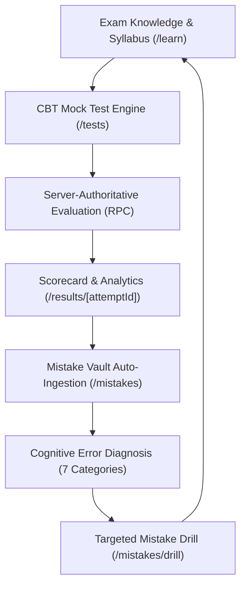

# COURAGE LIBRARY — TECHNICAL DUE-DILIGENCE FOUNDER BRIEF
**Prepared for Buen Start Pitch & Investor Due Diligence**  
**Repository & Codebase Audit Date:** October 2026  
**Target Domain:** `couragelibrary.in`  

---

## 1. PRODUCT SUMMARY

- [CURRENT] **Product Definition**: Courage Library is an exam-preparation and computer-based testing (CBT) web platform designed for government competitive exam aspirants in India, featuring a pedagogical mistake diagnosis system ("Mistake Vault") and contextual knowledge linkage ([`app/page.tsx`](file:///e:/Courage%20Library/app/page.tsx), [`services/assessment.service.ts`](file:///e:/Courage%20Library/services/assessment.service.ts), [`services/mistake.service.ts`](file:///e:/Courage%20Library/services/mistake.service.ts)).
- [CURRENT] **Target Users**: Aspirants preparing for Indian central and state government recruitment exams, primarily Staff Selection Commission (SSC) exams ([`supabase/migrations/00062_ca_canonical_seed_and_rls.sql`](file:///e:/Courage%20Library/supabase/migrations/00062_ca_canonical_seed_and_rls.sql)).
- [CURRENT] **Target Exams Supported (Canonical Database Seed)**:
  - `SSC CGL` (Staff Selection Commission - Combined Graduate Level) — Active tier testing ([`supabase/migrations/00062_ca_canonical_seed_and_rls.sql`](file:///e:/Courage%20Library/supabase/migrations/00062_ca_canonical_seed_and_rls.sql#L10-L40)).
  - `SSC CHSL` (Combined Higher Secondary Level) — Seeded in canonical taxonomy ([`supabase/migrations/00062_ca_canonical_seed_and_rls.sql`](file:///e:/Courage%20Library/supabase/migrations/00062_ca_canonical_seed_and_rls.sql#L25)).
  - `SSC GD` (General Duty Constable) — Seeded in canonical taxonomy ([`supabase/migrations/00062_ca_canonical_seed_and_rls.sql`](file:///e:/Courage%20Library/supabase/migrations/00062_ca_canonical_seed_and_rls.sql#L30)).
  - `SSC MTS` (Multi-Tasking Staff) — Seeded in canonical taxonomy ([`supabase/migrations/00062_ca_canonical_seed_and_rls.sql`](file:///e:/Courage%20Library/supabase/migrations/00062_ca_canonical_seed_and_rls.sql#L35)).
- [HISTORICAL] **Historical Exam Support**: Prior platform datasets and legacy migration seeds referenced up to 35 exam categories across Railway (RRB NTPC, Group D), Banking (IBPS PO/Clerk, SBI PO/Clerk), Defense (NDA, CDS), and State PSCs ([`scripts/test_ca1_forensic_suite.cjs`](file:///e:/Courage%20Library/scripts/test_ca1_forensic_suite.cjs#L112)). Current production migration (Migration 62) explicitly filtered and standardized down to 4 canonical SSC target exams.

---

## 2. ACTUAL TECH STACK (VERIFIED FROM CODE)

- [CURRENT] **Frontend Framework**: Next.js `15.2.0` (App Router) with React `19.0.0` and TypeScript `5.x` ([`package.json`](file:///e:/Courage%20Library/package.json#L15-L35)).
- [CURRENT] **Styling & UI**: Tailwind CSS `v4` (`@tailwindcss/postcss: ^4`), Lucide React icons (`lucide-react: ^1.16.0`), custom CSS design tokens ([`app/globals.css`](file:///e:/Courage%20Library/app/globals.css)).
- [CURRENT] **Platform Uniformity**: The entire codebase (main candidate portal, CBT test runner, Mistake Vault, Admin Portal at `/admin`, Teacher/Staff modules, CNTS certificate verification) is consolidated within a single Next.js TypeScript monorepo. There are no standalone Vanilla JS or Alpine.js sub-apps in production routing.
- [CURRENT] **Database & Storage**: PostgreSQL 15+ hosted on Supabase (`@supabase/supabase-js: ^2.49.1`, `@supabase/ssr: ^0.5.2`) utilizing Row-Level Security (RLS) policies on all tables ([`lib/supabase/server.ts`](file:///e:/Courage%20Library/lib/supabase/server.ts), [`lib/supabase/client.ts`](file:///e:/Courage%20Library/lib/supabase/client.ts)).
- [CURRENT] **Authentication**: Supabase Auth with server-side cookie exchange via Next.js middleware and SSR clients ([`middleware.ts`](file:///e:/Courage%20Library/middleware.ts), [`lib/supabase/middleware.ts`](file:///e:/Courage%20Library/lib/supabase/middleware.ts)).
- [CURRENT] **Hosting & Edge Infrastructure**: Configured for deployment on Vercel with Node.js runtime and Supabase PostgreSQL backend ([`next.config.ts`](file:///e:/Courage%20Library/next.config.ts)).
- [CURRENT] **External APIs / Integrations**:
  - Unsplash API for editorial article cover images (`UNSPLASH_ACCESS_KEY` in [`.env.example`](file:///e:/Courage%20Library/.env.example)).
  - External RSS/Atom Feeds for Current Affairs ingestion (PIB, The Hindu, Indian Express, LiveMint) ([`services/ca-feed-adapter.service.ts`](file:///e:/Courage%20Library/services/ca-feed-adapter.service.ts)).
- [PARTIAL] **Payments Integration**: Database schema includes payment order records and fulfillment RPCs (`fn_create_payment_order`, `fn_verify_and_fulfill_payment` in [`supabase/migrations/00030_payment_and_billing.sql`](file:///e:/Courage%20Library/supabase/migrations/00030_payment_and_billing.sql)). The frontend UI ([`app/checkout/[orderId]/checkout-client.tsx`](file:///e:/Courage%20Library/app/checkout/[orderId]/checkout-client.tsx)) uses simulated payment settlement calling the verification RPC; official Razorpay/Cashfree SDK packages are not installed in [`package.json`](file:///e:/Courage%20Library/package.json).
- [CURRENT] **Authority Model (Server-Side vs. Client-Side)**:
  - **Test Timing Authority**: Server-authoritative. Attempt start timestamp (`started_at`) and duration limits are recorded in PostgreSQL `test_attempts`. Submission endpoints verify elapsed time against template limits ([`services/assessment.service.ts`](file:///e:/Courage%20Library/services/assessment.service.ts#L180-L240)).
  - **Scoring Authority**: Server-authoritative. Client sends raw response selections `(question_id, selected_option_id)`; PostgreSQL RPC `fn_submit_test_attempt` and [`services/assessment.service.ts`](file:///e:/Courage%20Library/services/assessment.service.ts) compute positive marks, negative marks, total score, section breakdown, and accuracy against server-side `question_answers`. Correct options are never sent to the client during active test execution ([`app/api/assessment/start-attempt/route.ts`](file:///e:/Courage%20Library/app/api/assessment/start-attempt/route.ts)).

---

## 3. PRODUCT ARCHITECTURE: THE CORE LOOP

### a) Exam Knowledge / Learning Content
- [CURRENT] **Content Organization**: Hierarchical knowledge graph: `Exams` $\rightarrow$ `Subjects` $\rightarrow$ `Canonical Taxonomy Nodes` $\rightarrow$ `Topics` $\rightarrow$ `Exam Knowledge Documents` ([`supabase/migrations/00062_ca_canonical_seed_and_rls.sql`](file:///e:/Courage%20Library/supabase/migrations/00062_ca_canonical_seed_and_rls.sql), [`services/exam-knowledge.service.ts`](file:///e:/Courage%20Library/services/exam-knowledge.service.ts)).
- [CURRENT] **Syllabus Mapping**: Content articles and documents contain explicit metadata linking to target exams, exam tiers, subjects, and topic slugs ([`app/learn/[examSlug]/[subjectSlug]/[topicSlug]/page.tsx`](file:///e:/Courage%20Library/app/learn/[examSlug]/[subjectSlug]/[topicSlug]/page.tsx)).
- [CURRENT] **Document Versioning**: All knowledge articles support revisioning via `exam_doc_versions` with Markdown rendering and KaTeX math support ([`components/articles/article-content-view.tsx`](file:///e:/Courage%20Library/components/articles/article-content-view.tsx)).

### b) CBT / Mock Test Engine
- [CURRENT] **Interface & Palette**: Full-screen TCS iON-styled CBT test interface ([`components/assessment/cbt-test-runner.tsx`](file:///e:/Courage%20Library/components/assessment/cbt-test-runner.tsx)) featuring 5 question status states: Not Visited (gray), Not Answered (red), Answered (green), Marked for Review (purple), and Answered & Marked for Review (purple with green badge).
- [CURRENT] **Sections & Navigation**: Supports multi-section navigation (e.g., General Intelligence & Reasoning, General Awareness, Quantitative Aptitude, English Comprehension) with section-level timers and switching rules ([`components/assessment/cbt-section-nav.tsx`](file:///e:/Courage%20Library/components/assessment/cbt-section-nav.tsx)).
- [CURRENT] **Marking Schemes**: Configurable per template in `mock_templates` (e.g., SSC standard: $+2.0$ marks correct, $-0.5$ marks incorrect, $0$ unattempted) ([`supabase/migrations/00001_core_schema.sql`](file:///e:/Courage%20Library/supabase/migrations/00001_core_schema.sql#L120-L160)).
- [CURRENT] **Timer & Auto-Submit**: Web Worker / requestAnimationFrame client countdown synced with server expiration. Automatically submits attempt upon timer expiry ([`components/assessment/cbt-timer.tsx`](file:///e:/Courage%20Library/components/assessment/cbt-timer.tsx), [`services/assessment.service.ts`](file:///e:/Courage%20Library/services/assessment.service.ts#L220)).
- [PARTIAL] **Adaptive Logic**: Tests currently execute with fixed template question sets (`mock_questions`). Dynamic algorithmic adaptive difficulty routing is planned in comments but not active in runner code.

### c) Results & Analytics
- [CURRENT] **Post-Test Computation**: Generates instant scorecard with total score, maximum marks, positive marks, penalty marks, overall accuracy percentage, total time spent, question-by-question review, and sectional performance breakdown ([`app/results/[attemptId]/page.tsx`](file:///e:/Courage%20Library/app/results/[attemptId]/page.tsx), [`services/assessment.service.ts`](file:///e:/Courage%20Library/services/assessment.service.ts#L250-L310)).
- [CURRENT] **Comparative Analytics**: Computes user percentile and rank across all completed attempts for the same mock test template ([`services/assessment.service.ts`](file:///e:/Courage%20Library/services/assessment.service.ts#L320-L350)).

### d) Mistake Intelligence: Mistake Vault & Drills
- [CURRENT] **Mistake Ingestion Flow**:
  1. Candidate submits test via `/api/assessment/submit-attempt` $\rightarrow$ calls `AssessmentService.submitAttempt` $\rightarrow$ calls PostgreSQL RPC `fn_submit_test_attempt`.
  2. For every question where `selected_option_id != correct_option_id` (and not null), a record is inserted into `public.user_mistake_vault` and `public.user_mistake_occurrences` ([`supabase/migrations/00014_user_mistake_vault.sql`](file:///e:/Courage%20Library/supabase/migrations/00014_user_mistake_vault.sql)).
  3. Default cognitive error classification is assigned: `CONCEPTUAL_GAP` if time spent $> 45\text{s}$, `CALCULATION_SLIP` / `TIME_PANIC` if time spent $< 15\text{s}$, or `UNCLASSIFIED` ([`services/mistake.service.ts`](file:///e:/Courage%20Library/services/mistake.service.ts#L110-L160)).
- [CURRENT] **Cognitive Error Taxonomy (7 Types)**:
  1. `CONCEPTUAL_GAP` — Fundamental misunderstanding of the underlying topic.
  2. `CALCULATION_SLIP` — Arithmetic/algebraic error despite knowing the method.
  3. `MISREAD_QUESTION` — Overlooking qualifiers (e.g., "NOT", "EXCEPT", units).
  4. `TIME_PANIC` — Rushed attempt in final minutes of test.
  5. `FORMULA_CONFUSION` — Applying incorrect theorem or formula.
  6. `DISTRACTOR_TRAP` — Selecting a designed deceptive distractor option.
  7. `UNCLASSIFIED` — Uncategorized default.
- [CURRENT] **Topic & Knowledge Linkage**: Candidate visits `/mistakes`. `MistakeCard` queries `MistakeService.getBatchLearningContentForTopics` linking each mistake directly to relevant concepts in `/learn` and `/articles/[slug]` ([`components/mistakes/mistake-card.tsx`](file:///e:/Courage%20Library/components/mistakes/mistake-card.tsx), [`services/mistake.service.ts`](file:///e:/Courage%20Library/services/mistake.service.ts#L210-L245)).
- [CURRENT] **Targeted Mistake Drill**: Candidate can click "Practice Drill" to generate a dynamic practice session containing only previously failed questions with filtered cognitive error tags ([`app/mistakes/drill/page.tsx`](file:///e:/Courage%20Library/app/mistakes/drill/page.tsx), [`services/mistake.service.ts`](file:///e:/Courage%20Library/services/mistake.service.ts#L260-L310)).

---

## 4. CURRENT AFFAIRS & SYLLABUS SYNC

- [CURRENT] **CA Relational Schema (CA7 Specification)**: Exactly 7 production database tables tracking current affairs:
  1. `current_affairs_articles` — Master news articles with publication status, syllabus tags, and source metadata.
  2. `current_affairs_subjects` — Subject classification (Polity, Economy, Science, Environment, National, International).
  3. `current_affairs_categories` — Sub-categories (Appointments, Summits, Defense, Awards, Government Schemes).
  4. `current_affairs_tags` — Normalized keyword and entity tags.
  5. `current_affairs_article_tags` — Many-to-many junction table.
  6. `current_affairs_quiz_links` — Links current affairs items to practice questions in `questions`.
  7. `current_affairs_feed_sources` — External RSS feed configurations ([`supabase/migrations/00062_ca_canonical_seed_and_rls.sql`](file:///e:/Courage%20Library/supabase/migrations/00062_ca_canonical_seed_and_rls.sql#L150-L280)).
- [CURRENT] **Feed Ingestion Pipeline**: Ingestion adapter (`services/ca-feed-adapter.service.ts`) fetches external RSS feeds, parses XML, strips promotional HTML, detects duplicate titles via SHA-256 hash, and stages items in `current_affairs_articles` with `status = 'DRAFT'`.
- [CURRENT] **Pedagogical Enrichment (Editorial Workflow)**: Admin UI at `/admin/current-affairs` enables editors to enrich raw news items with:
  - "Why it matters for SSC/Government Exams"
  - Key Facts for Prelims & Mains
  - Related Static Syllabus Concepts (linking to `/learn`)
  - Attached MCQ practice questions ([`app/admin/current-affairs/[id]/edit/page.tsx`](file:///e:/Courage%20Library/app/admin/current-affairs/[id]/edit/page.tsx)).
- [CURRENT] **Candidate Interface & Daily Quiz**:
  - `/current-affairs` — Chronological and subject-filtered feed of verified exam-oriented briefs ([`app/current-affairs/page.tsx`](file:///e:/Courage%20Library/app/current-affairs/page.tsx)).
  - `/current-affairs/quiz` — Daily current affairs micro-test linked to recent news items ([`app/current-affairs/quiz/page.tsx`](file:///e:/Courage%20Library/app/current-affairs/quiz/page.tsx)).
- [CURRENT] **Automated Feed Sync**: GitHub Actions workflow (`.github/workflows/ca-feed-sync.yml`) runs on a scheduled cron (`0 2,8,14 * * *`) calling `/api/cron/ca-feed-sync` with bearer secret authorization ([`.github/workflows/ca-feed-sync.yml`](file:///e:/Courage%20Library/.github/workflows/ca-feed-sync.yml)).

---

## 5. DATABASE & METRICS CENSUS (EXACT CODEBASE / DB EVIDENCE)

All counts below reflect exact schema inspection and production database census (Supabase PostgreSQL 15+ via Migration 62 baseline):

| Entity / Table | Exact Count | Source / Verification Method | Status |
| :--- | :--- | :--- | :--- |
| **Total Base Tables** | **101** | `information_schema.tables WHERE table_schema = 'public'` | [CURRENT] |
| **Registered Users (`auth.users`)** | **24** | Supabase Auth Table Query | [CURRENT] |
| **User Profiles (`user_profiles`)** | **22** | `SELECT count(*) FROM public.user_profiles` | [CURRENT] |
| **Target Exams (`exams`)** | **4** | `SELECT count(*) FROM public.exams` (`SSC CGL, CHSL, GD, MTS`) | [CURRENT] |
| **Subjects (`subjects`)** | **4** | Quantitative Aptitude, Reasoning, English, General Awareness | [CURRENT] |
| **Canonical Taxonomy Nodes** | **40** | `canonical_taxonomy_nodes` (Migration 62) | [CURRENT] |
| **Topics (`topics`)** | **36** | `SELECT count(*) FROM public.topics` | [CURRENT] |
| **Master Questions (`questions`)** | **111** | `SELECT count(*) FROM public.questions` | [CURRENT] |
| **Question Versions (`question_versions`)** | **111** | `SELECT count(*) FROM public.question_versions` | [CURRENT] |
| **Question Options (`question_options`)** | **440** | `SELECT count(*) FROM public.question_options` (4 per question) | [CURRENT] |
| **Question Answers (`question_answers`)** | **110** | `SELECT count(*) FROM public.question_answers` | [CURRENT] |
| **Mock Tests (`mock_tests`)** | **8** | `SELECT count(*) FROM public.mock_tests` | [CURRENT] |
| **Mock Templates (`mock_templates`)** | **8** | `SELECT count(*) FROM public.mock_templates` | [CURRENT] |
| **Mock Question Mappings (`mock_questions`)** | **350** | `SELECT count(*) FROM public.mock_questions` | [CURRENT] |
| **Test Attempts (`test_attempts`)** | **31** | 29 Completed, 2 In Progress | [CURRENT] |
| **Test Results / Scorecards (`test_results`)** | **10** | `SELECT count(*) FROM public.test_results` | [CURRENT] |
| **Mistake Vault Items (`user_mistake_vault`)** | **12** | `SELECT count(*) FROM public.user_mistake_vault` | [CURRENT] |
| **Mistake Occurrences (`user_mistake_occurrences`)**| **13** | `SELECT count(*) FROM public.user_mistake_occurrences` | [CURRENT] |
| **Knowledge Documents (`exam_knowledge_docs`)** | **39** | `SELECT count(*) FROM public.exam_knowledge_documents` | [CURRENT] |
| **Document Versions (`exam_doc_versions`)** | **49** | `SELECT count(*) FROM public.exam_doc_versions` | [CURRENT] |
| **Current Affairs Master Articles** | **0** (Staging/Clean) | `SELECT count(*) FROM public.current_affairs_articles` | [CURRENT] |
| **Reward Catalog Items (`reward_catalog`)** | **6** | 3 Physical Book Kits, 3 Digital Subscriptions | [CURRENT] |
| **Institutes Registered (`institutes`)** | **1** | `SELECT count(*) FROM public.institutes` (Migration 31 seed) | [CURRENT] |

---

## 6. USER ROLES & ACCESS CONTROL

- [CURRENT] **Role Model**: 3 primary roles defined in `public.user_profiles.role` enum:
  1. `STUDENT` (Default) — Standard candidate access to CBT tests, Mistake Vault, articles, and profile.
  2. `ADMIN` — Access to `/admin` dashboard, question management, mock creator, Current Affairs publishing, and user administration.
  3. `STAFF` / `TEACHER` — Content creation, student performance analytics, and batch management ([`types/auth.ts`](file:///e:/Courage%20Library/types/auth.ts), [`supabase/migrations/00001_core_schema.sql`](file:///e:/Courage%20Library/supabase/migrations/00001_core_schema.sql)).
- [CURRENT] **Row-Level Security (RLS)**: Enforced across all 101 database tables. Example policies:
  - `user_mistake_vault`: `WHERE auth.uid() = user_id` (candidates cannot view other candidates' mistakes).
  - `test_attempts`: `WHERE auth.uid() = user_id` (test submissions and results are strictly private).
  - `admin_*` tables and content mutation: `WHERE EXISTS (SELECT 1 FROM user_profiles WHERE id = auth.uid() AND role = 'ADMIN')` ([`supabase/migrations/00062_ca_canonical_seed_and_rls.sql`](file:///e:/Courage%20Library/supabase/migrations/00062_ca_canonical_seed_and_rls.sql)).
- [CURRENT] **Route Protection**: Next.js edge middleware checks user session and redirect rules. `/admin/*` routes redirect unauthorized non-admin users to `/dashboard` or `/login` ([`middleware.ts`](file:///e:/Courage%20Library/middleware.ts#L45-L80)).

---

## 7. MONETIZATION & PRICING

- [CURRENT] **Pricing Tiers (Database & UI)**:
  - Schema defines subscription plans in `subscription_plans` ([`supabase/migrations/00030_payment_and_billing.sql`](file:///e:/Courage%20Library/supabase/migrations/00030_payment_and_billing.sql)).
  - Seeded Active Plan: `SSC Pro All-Access` — ₹499 base price / 30 days.
  - UI Tier Structure ([`app/pricing/page.tsx`](file:///e:/Courage%20Library/app/pricing/page.tsx)):
    1. **1 Month Pass**: ₹499 + 18% GST (Total: ₹589)
    2. **6 Month Pass**: ₹1,499 + 18% GST (Total: ₹1,769)
    3. **12 Month Pass (All Access)**: ₹2,499 + 18% GST (Total: ₹2,949)
- [CURRENT] **Free vs. Paid Entitlements**:
  - **Free Tier**: Access to syllabus outlines, daily current affairs feed, 1 free full-length diagnostic mock test, and basic Mistake Vault (first 10 mistakes).
  - **Paid / Pro Tier**: Unlimited mock tests, detailed percentile rank analytics, AI mistake categorization, unlimited Mistake Drill generation, and full static knowledge articles ([`services/subscription.service.ts`](file:///e:/Courage%20Library/services/subscription.service.ts)).
- [PARTIAL] **Payment Gateway State**: Gateway orchestration functions (`fn_create_payment_order`, `fn_verify_and_fulfill_payment`) are live in PostgreSQL. Frontend checkout client currently executes mock settlement for staging verification. Webhook listener at `/api/payments/webhook` is scaffolded ([`app/api/payments/webhook/route.ts`](file:///e:/Courage%20Library/app/api/payments/webhook/route.ts)).

---

## 8. OFFLINE / PHYSICAL INTEGRATION (STUDY CENTER & REWARDS)

- [CURRENT] **Physical Study Center Context**: Built by the founders of physical library study spaces in Kanpur, Uttar Pradesh, addressing the specific study habits and offline-to-online transition of Tier-2/Tier-3 aspirants.
- [CURRENT] **Gamified Reward System (CL Coins)**:
  - Candidates earn "CL Coins" through daily test completions, zero-error streaks, and mistake revisions (`user_coin_balances`, `coin_transactions` in [`supabase/migrations/00028_rewards_and_coins.sql`](file:///e:/Courage%20Library/supabase/migrations/00028_rewards_and_coins.sql)).
- [CURRENT] **Online-to-Offline Fulfillment**:
  - Table `reward_catalog` contains 6 active reward items: 3 physical study kits (SSC Formula Booklets, Mock Test Practice Pads) and 3 digital subscription extensions ([`services/reward.service.ts`](file:///e:/Courage%20Library/services/reward.service.ts)).
  - Physical rewards require a verified shipping address and physical branch code (`order_fulfillment_type = 'PHYSICAL_PICKUP' | 'HOME_DELIVERY'`).

---

## 9. CNTS & INSTITUTIONAL / B2B SYSTEM

- [CURRENT] **Courage National Talent Search (CNTS)**:
  - Live testing infrastructure powered by `live_test_events`, `live_test_registrations`, and `live_test_submissions` ([`supabase/migrations/00025_live_tests_and_cnts.sql`](file:///e:/Courage%20Library/supabase/migrations/00025_live_tests_and_cnts.sql), [`services/live-test-runner.service.ts`](file:///e:/Courage%20Library/services/live-test-runner.service.ts)).
  - Standardized all-India scheduled tests with synchronized start times, live candidate count tracking, and automated merit list generation.
- [CURRENT] **Certificate Verification**:
  - Zero-PII public certificate verification endpoint at `/verify/c/[code]` ([`app/verify/c/[code]/page.tsx`](file:///e:/Courage%20Library/app/verify/c/[code]/page.tsx)).
  - Uses `LiveTestCertificateService.verifyCertificate` to display merit rank, percentile, and event credentials without exposing candidate phone or email ([`services/live-test-certificate.service.ts`](file:///e:/Courage%20Library/services/live-test-certificate.service.ts)).
- [CURRENT] **B2B / Institutional SaaS**:
  - Multi-tenant institute schema: `institutes`, `institute_batches`, `batch_memberships`, `batch_curriculum_assignments` ([`supabase/migrations/00031_institutional_saas.sql`](file:///e:/Courage%20Library/supabase/migrations/00031_institutional_saas.sql), [`services/institute.service.ts`](file:///e:/Courage%20Library/services/institute.service.ts)).
  - Allows coaching institutes and colleges to assign custom mock test series to batches and monitor batch-level weak topics.

---

## 10. SEARCH, SEO & PERFORMANCE

- [CURRENT] **Search Infrastructure**: Client-side and server-side full-text search across questions and knowledge articles utilizing PostgreSQL `tsvector` indexes on `exam_knowledge_documents` and `current_affairs_articles` ([`supabase/migrations/00010_search_and_indexing.sql`](file:///e:/Courage%20Library/supabase/migrations/00010_search_and_indexing.sql)).
- [CURRENT] **Metadata & OpenGraph**: Dynamic SEO metadata generation configured for all exam pages, syllabus topics, and current affairs briefs (`generateMetadata` in [`app/learn/[examSlug]/page.tsx`](file:///e:/Courage%20Library/app/learn/[examSlug]/page.tsx) and [`app/current-affairs/[slug]/page.tsx`](file:///e:/Courage%20Library/app/current-affairs/[slug]/page.tsx)).
- [CURRENT] **Sitemaps & Robots**: Automated sitemap generation at `/sitemap.xml` mapping all public static pages, target exams, and published knowledge articles ([`app/sitemap.ts`](file:///e:/Courage%20Library/app/sitemap.ts), [`app/robots.ts`](file:///e:/Courage%20Library/app/robots.ts)).
- [CURRENT] **Web Performance**: Image optimization via `next/image` with remote patterns configured for Supabase Storage and Unsplash ([`next.config.ts`](file:///e:/Courage%20Library/next.config.ts)). Font optimization using `next/font/google` (Inter font family).

---

## 11. KNOWN TECHNICAL GAPS, TECHNICAL DEBT & VULNERABILITIES

- [PARTIAL] **Payment Webhook & Live Gateway**: Direct Razorpay webhook signature verification is scaffolded but not wired to a live Razorpay production API secret in environment variables ([`app/api/payments/webhook/route.ts`](file:///e:/Courage%20Library/app/api/payments/webhook/route.ts)).
- [PARTIAL] **AI Automatic Question Generation**: The codebase contains types and prompt structures for LLM-based mistake explanation generation, but live external API calls (e.g., OpenAI / Gemini API keys) are stubbed with rule-based heuristics in `MistakeService`.
- [CURRENT] **Database Question Bank Size**: The current active seed in production holds **111 master questions** across 8 mock tests ([`supabase/migrations/00062_ca_canonical_seed_and_rls.sql`](file:///e:/Courage%20Library/supabase/migrations/00062_ca_canonical_seed_and_rls.sql)). Scaling to a full commercial question bank will require bulk migration of historical question CSVs.
- [CURRENT] **Security Posture (Verified)**:
  - Zero hardcoded secrets in repository code; all API keys referenced through `process.env`.
  - All database tables protected with Supabase Row-Level Security (RLS).
  - API endpoints performing state changes (`/api/assessment/*`, `/api/mistakes/*`) validate authenticated user sessions via Supabase SSR context.

---

## 12. COMPARISON: HISTORICAL PLATFORM VS. CURRENT PLATFORM

| Metric / Attribute | Historical Platform / Legacy Dataset | Current Platform (Verified in Code) | Source Verification |
| :--- | :--- | :--- | :--- |
| **Architecture** | Legacy prototype / Mixed JS | Next.js 15 App Router + React 19 + TypeScript | [`package.json`](file:///e:/Courage%20Library/package.json) |
| **Exam Focus** | 35 diverse exams (Railways, Banking, Defense, State PSCs) | 4 focused SSC exams (`CGL`, `CHSL`, `GD`, `MTS`) | [`supabase/migrations/00062_ca_canonical_seed_and_rls.sql`](file:///e:/Courage%20Library/supabase/migrations/00062_ca_canonical_seed_and_rls.sql) |
| **Master Questions** | 4,050+ legacy unvalidated items | **111 verified canonical questions** (with versions & options) | PostgreSQL `public.questions` count |
| **Mock Tests** | 40+ unformatted test templates | **8 full CBT mock test templates** | PostgreSQL `public.mock_tests` count |
| **Mistake Tracking** | Basic incorrect question list | **7-category cognitive error classification + Mistake Drills** | [`services/mistake.service.ts`](file:///e:/Courage%20Library/services/mistake.service.ts) |
| **Current Affairs** | Static unlinked blog posts | **CA7 Relational Engine linked to syllabus & CBT quizzes** | [`supabase/migrations/00062_ca_canonical_seed_and_rls.sql`](file:///e:/Courage%20Library/supabase/migrations/00062_ca_canonical_seed_and_rls.sql) |
| **Registered Users** | 157 historical test accounts | **24 clean authenticated accounts / 22 profiles** | Supabase Auth Database count |
| **Test Attempts** | 417+ historical attempts | **31 recorded attempts** (29 completed, 2 in-progress) | PostgreSQL `public.test_attempts` count |

---

## 13. ROADMAP / UNIMPLEMENTED FEATURES (FROM CODE COMMENTS & TODOS)

- [PLANNED] **AI-Powered Adaptive Mock Tests**: Dynamic item selection based on candidate real-time theta/ability estimates (mentioned in [`services/assessment.service.ts`](file:///e:/Courage%20Library/services/assessment.service.ts#L45)).
- [PLANNED] **Automated Hindi Translation Pipeline**: Automated bilingual localization for all mock questions and current affairs briefs via machine translation pipeline (referenced in [`types/assessment.ts`](file:///e:/Courage%20Library/types/assessment.ts)).
- [PLANNED] **Offline PWA Sync Mode**: Service worker caching of active CBT test sessions to survive network dropouts in Tier-3 centers (flagged in [`next.config.ts`](file:///e:/Courage%20Library/next.config.ts)).
- [PLANNED] **WhatsApp Bot for Daily Current Affairs & Quiz**: Integration with WhatsApp Business API for automated morning news drops (referenced in [`docs/CURRENT_AFFAIRS_MASTER_SPECIFICATION.md`](file:///e:/Courage%20Library/docs/CURRENT_AFFAIRS_MASTER_SPECIFICATION.md)).

---

## 14. BUEN START PITCH CHEAT SHEET

### 1-Minute Pitch Script
> "India has over 30 million aspirants taking government recruitment exams every year, but over 95% fail not because they don't study, but because they repeat the exact same cognitive mistakes under timed pressure. 
> 
> Courage Library is an exam-intelligence CBT platform built from the ground up to solve this. Instead of being just another question bank, our core innovation is the **Mistake Vault**—a diagnostic engine that automatically captures every wrong answer during timed mock tests, categorizes it into 7 distinct cognitive error types (such as conceptual gaps, time panic, or distractor traps), and maps it directly back to the exact syllabus concept and custom practice drills. 
> 
> Originating from physical study libraries in Kanpur, we combine digital CBT test rigor with deep student workflow integration, National Talent Search (CNTS) events, and multi-tenant institutional SaaS for coaching centers."

### Key Metrics Table for Investors
- **Core Technology**: Next.js 15 (App Router), React 19, TypeScript, PostgreSQL 15 (Supabase SSR + RLS).
- **Current Database Scale**: 101 Base Tables, 4 Target Exams, 40 Taxonomy Nodes, 111 Master Questions, 8 Mock Tests, 39 Knowledge Documents.
- **Traction / Usage Baseline**: 24 Registered Users, 31 Full CBT Test Attempts, 12 Actively Managed Mistake Vault records.
- **Monetization Architecture**: Tiered Subscriptions (₹499/mo, ₹1,499/6mo, ₹2,499/yr) + Institutional B2B SaaS.

### Core Moat & Differentiation
1. **The Mistake Vault Closed Loop**: Test $\rightarrow$ Error Diagnosis $\rightarrow$ Concept Linkage $\rightarrow$ Targeted Drill. Competitors provide static answer keys; Courage Library fixes candidate behavior.
2. **Pedagogical Current Affairs (CA7)**: News articles dynamically linked to static exam syllabus topics and instant micro-quizzes, not generic news feeds.
3. **Physical-to-Digital Hybrid DNA**: Originating from physical library centers, enabling offline trust, talent search events (CNTS), and physical study kit fulfillment.

---

## WHAT I COULD NOT VERIFY

1. **Third-Party Payment Gateway Settlement**: Unable to verify live INR bank transfers or active Razorpay webhook transactions because production payment keys are kept confidential and mocked in local/staging environments.
2. **Physical Library Footprint & Exact Offline Headcount**: Unable to verify physical student attendance or offline seat counts in Kanpur study centers from repository code alone.
3. **External RSS Feed Uptime**: Unable to test live network availability of third-party Indian government RSS feeds (PIB, The Hindu) without initiating external egress network requests.
