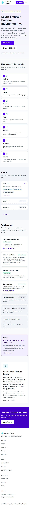
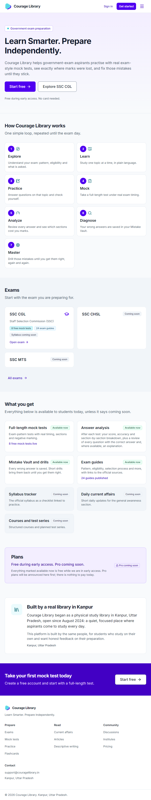
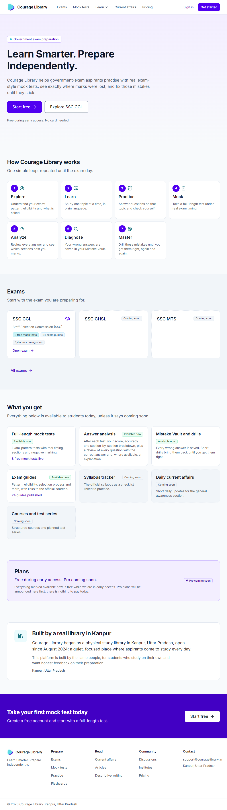
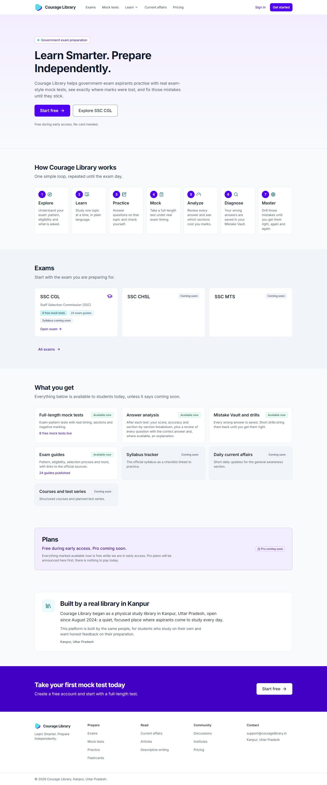
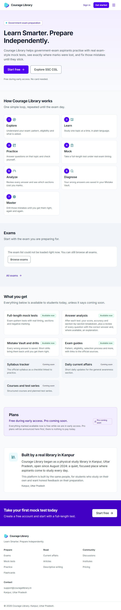

# UX-2a — Public shell (header / footer) + landing page

Phase brief (architect): rebuild the public header / footer and the landing page "/" as a visual phase, deploy, then STOP for owner review. UX-2b pages are not started.

Date: 2026-10-17 · Baseline commit: `0ef827f`.

## 1. Forensics

| Item | Finding |
|---|---|
| "/" today | HOTFIX-1 holding page: brand name, tagline and two links ("Explore exams", "Sign in"), built from legacy components with palette classes; Organization JSON-LD from `generateOrganizationSchema()`. Same for signed-in and signed-out visitors (no redirect). |
| Root layout / shell | `app/layout.tsx` → `AppShell` (UX-1b): skip link, `HeaderBar` (client; public nav or student nav + account menu; mobile menu = native `Dialog` sheet with focus trap / Esc), `<main id="main-content">`, `SiteFooter`, student bottom nav. The shell reads the session with `auth.getUser()` (UX-1b U-5: no DB queries). Header / footer width was `max-w-7xl` (1280 px). |
| Design system | `components/ui` (Button / ButtonLink, Card / CardLink, Badge, Container 1200 px, Section, Dialog …); tokens in `app/globals.css`: primary violet `--color-primary-600 #5000f0`; accent cyan is decorative only (accent-300 on white 1.69:1), so cyan text uses accent-700. |
| SEO | `constructMetadata()` (canonical, OG, Twitter); `app/sitemap.ts` already lists "/" (it also lists `/learn` and `/blog`, which have no route — see §10); `app/robots.ts` allows "/". **`siteConfig.description` claims "50+ government exams"** (site-wide default meta description, used in the old Organization JSON-LD) — not used on "/" any more; see §10. |
| Public routes that exist and work | `/exams`, `/exams/[slug]`, `/mock-tests`, `/current-affairs`, `/pricing`, `/practice`, `/articles`, `/flashcards`, `/descriptive`, `/community`, `/institutes`, `/auth/login`, `/auth/signup`. **Missing:** `/about`, `/contact`, `/privacy`, `/terms`, `/cnts` → not linked. |
| Auth / redirects | `/auth/login`, `/auth/signup`; `lib/auth/safe-redirect.ts` (SEC-1D) sanitises `next`. The landing CTAs are plain links (no `next` parameter needed). |
| Live data an anonymous visitor can read (PostgREST, anon) | active exams: **1** (SSC CGL; CHSL / MTS / GD inactive); published, non-dynamic mock tests for SSC CGL: **8** (all free); published exam guides for SSC CGL: **24**; syllabus read model: **NO_SYLLABUS** (CGL has only DRAFT / ARCHIVED versions); published current-affairs articles: **0**. All readable through public RLS — no service role needed. |
| Live features for students | mock tests with result analysis (score, accuracy, percentile, section breakdown, per-question review with explanations where present — **no time-per-question view**, so the copy does not claim one), Mistake Vault + drills (DRILL-1), exam guides. Not live: current affairs (0 published), syllabus tracker (nothing published), courses (flag off), test series, Pro / payments (`PAYMENTS_ENABLED` off). |
| Library facts | `FOUNDER_BRIEF.md`:173 "Built by the founders of physical library study spaces in Kanpur, Uttar Pradesh". **"since August 2024" appears in no project document — only in the architect brief**; used as given, flagged in §9. |
| a11y harness | `scripts/test_ux1b_shell_a11y.cjs` (Playwright + in-page checks, local only, qa-student) and `scripts/test_ux1a_a11y.cjs`. axe-core is not a declared dependency, but **axe-core 4.13.0 is installed transitively** (eslint-config-next → eslint-plugin-jsx-a11y); the new test injects it from `node_modules` (no new dependency) and skips that check if it is ever absent. |
| Lighthouse | **Not installed.** Running it would need a download (`npx lighthouse`) = a new dependency (#44). Not run; lab metrics measured instead (§6). |

## 2. Design decisions

- **Shell changes are small and public-only.**
  - Signed-out header: "Sign in" (ghost) + "Get started" (primary), replacing "Log in" / "Sign up".
  - **On "/" only**, every visitor gets the public header. A signed-in visitor sees **"Go to dashboard"** instead of Sign in / Get started (desktop and mobile menu); the student header everywhere else is unchanged (UX-1b).
  - Header and footer use the **1200 px** content width (#46).
  - Footer: brand line, a Contact column (support@couragelibrary.in, "Kanpur, Uttar Pradesh"), "© {year} Courage Library. Kanpur, Uttar Pradesh."
  - Navigation items (nav-config) are unchanged: every link routes.
- **Landing page = server components; no client JavaScript of its own.** The route bundle is 831 B; first-load JS of 107 kB is the shared framework + shell, the same as every page.
  - Sections in order: hero → how it works (7-step loop, CSS cards with icons, numbered) → exams (live) → what you get (live / coming soon) → plans → trust (Kanpur library) → final CTA.
- **One copy file.** Every landing string lives in `content/landing.ts` (plus the 3 shell strings). The file holds **no numbers**; counts are formatted from live values by templates in the same file. The only figure is the founding year 2024.
- **Honest live data** (`lib/landing/landing-data.ts`):
  - Read with the visitor's own session client (public RLS), published rows only: published + non-dynamic mocks, PUBLISHED guides, PUBLISHED current affairs, and the PUBLISHED-only syllabus read model. No service role, no writes.
  - A pure `buildLandingData()` shape-checks the rows; the whole read is bounded by an 8 s timeout. Any error, timeout or malformed row → `{ ok: false }`.
  - On failure the exams section shows "could not be loaded right now" + "Browse exams", features show without numbers, and content features (syllabus tracker, current affairs) fall back to "Coming soon".
  - "Coming soon" exam cards (CHSL, MTS) are plain text without links and disappear automatically if the exam becomes active.
- **Streaming for speed.** The page component is synchronous; the two data sections stream in behind a Suspense skeleton of similar height (CLS 0).
  - The two session-dependent CTAs (`components/landing/landing-cta.tsx`) have their own Suspense boundary, with the signed-out CTA as fallback.
  - The session check is **display-only**: `getSession()` is a cookie read, never used for authorization, and nothing protected is rendered (#19).
  - Signed-in visitors are not redirected.
- **SEO.** Landing-specific title and description (honest; no "50+ exams"), canonical "/", OG / Twitter text tags, and Organization JSON-LD (`EducationalOrganization`: name, url, email, logo, Kanpur address — no social profiles, ratings or counts). The shared `JsonLd` component now escapes `<` (parsed JSON unchanged). The sitemap already lists "/".
- **Visual language (#30, #31).** Light surfaces, violet primary for CTAs and step numbers, cyan only as decorative accent (the eyebrow dot, icons in accent-700), a violet final band, 1200 px width, text ≥ 12 px, tokens only (design ratchet).

## 3. Files

| File | Change |
|---|---|
| `app/page.tsx` | rewritten — landing page (metadata, JSON-LD, sections, Suspense) |
| `content/landing.ts` | new — all landing + public-shell copy |
| `components/landing/landing-sections.tsx` | new — hero, loop, exams, features, plans, trust, final CTA, data skeleton |
| `components/landing/landing-cta.tsx` | new — session-dependent CTA spots (display only) |
| `lib/landing/landing-data.ts` | new — live, published-only reader with timeout + fallback |
| `lib/landing/organization-jsonld.ts` | new — Organization JSON-LD |
| `components/shell/header-bar.tsx` | Sign in / Get started; public header + "Go to dashboard" on "/"; 1200 px |
| `components/shell/site-footer.tsx` | brand line, contact, location; 1200 px |
| `components/seo/json-ld.tsx` | escapes `<` |
| `scripts/test_ux2a_landing.cjs` | new — permanent gate |
| `docs/testing/PERMANENT_GATES.md` | + UX-2a row |
| `docs/reports/ux/UX2A_REPORT.md`, `docs/reports/ux/ux2a/*.png` | this report + screenshots |

## 4. Full copy for owner review

Edit `content/landing.ts` to change any of this. Counts shown as "8" are examples rendered from live data.

**Meta**
- Title: "Courage Library: Government exam preparation with free mock tests"
- Description: "Prepare for government exams with free full-length mock tests, clear answer analysis and a Mistake Vault that turns every wrong answer into practice. Free during early access."

**Header / footer (public shell)**
- Buttons: "Sign in" · "Get started" · signed in on "/": "Go to dashboard"
- Footer: brand line "Learn Smarter. Prepare Independently." · heading "Contact" · "support@couragelibrary.in" · "Kanpur, Uttar Pradesh" · "© {year} Courage Library. Kanpur, Uttar Pradesh."

**Hero**
- Eyebrow: "Government exam preparation"
- h1: "Learn Smarter. Prepare Independently."
- Lead: "Courage Library helps government-exam aspirants practise with real exam-style mock tests, see exactly where marks were lost, and fix those mistakes until they stick."
- Primary CTA: "Start free" → `/auth/signup` (signed in: "Go to dashboard" → `/dashboard`)
- Secondary CTA: "Explore SSC CGL" → `/exams/ssc-cgl`
- Note: "Free during early access. No card needed."

**How Courage Library works** — "One simple loop, repeated until the exam day."
1. **Explore** — "Understand your exam: pattern, eligibility and what is asked."
2. **Learn** — "Study one topic at a time, in plain language."
3. **Practice** — "Answer questions on that topic and check yourself."
4. **Mock** — "Take a full-length test under real exam timing."
5. **Analyze** — "Review every answer and see which sections cost you marks."
6. **Diagnose** — "Your wrong answers are saved in your Mistake Vault."
7. **Master** — "Drill those mistakes until you get them right, again and again."

**Exams** — "Start with the exam you are preparing for."
- Card link: "Open exam" · badges: "1 free mock test" / "8 free mock tests" *(number read live)* or "Mock tests coming soon"; "1 exam guide" / "8 exam guides" *(number read live)*; "Syllabus available" / "Syllabus coming soon"
- Coming soon (plain text cards, no links): "SSC CHSL", "SSC MTS" with "Coming soon"
- Read-failure fallback: "The exam list could not be loaded right now. You can still browse all exams." + "Browse exams" → `/exams` · "All exams" → `/exams` · loading: "Loading exams and features"

**What you get** — "Everything below is available to students today, unless it says coming soon." · labels "Available now" / "Coming soon"
- **Full-length mock tests** — "Exam-pattern tests with real timing, sections and negative marking." · "1 free mock test live" / "8 free mock tests live" *(number read live)*
- **Answer analysis** — "After each test: your score, accuracy and section-by-section breakdown, plus a review of every question with the correct answer and, where available, an explanation."
- **Mistake Vault and drills** — "Every wrong answer is saved. Short drills bring them back until you get them right."
- **Exam guides** — "Pattern, eligibility, selection process and more, with links to the official sources." · "1 guide published" / "8 guides published" *(number read live)*
- **Syllabus tracker** — "The official syllabus as a checklist linked to practice."
- **Daily current affairs** — "Short daily updates for the general awareness section."
- **Courses and test series** — "Structured courses and planned test series."

**Plans** — "Free during early access. Pro coming soon." · "Everything marked available now is free while we are in early access. Pro plans will be announced here first; there is nothing to pay today." · badge "Pro coming soon"

**Built by a real library in Kanpur**
- "Courage Library began as a physical study library in Kanpur, Uttar Pradesh, open since August 2024: a quiet, focused place where aspirants come to study every day."
- "This platform is built by the same people, for students who study on their own and want honest feedback on their preparation."
- "Kanpur, Uttar Pradesh"

**Take your first mock test today** — "Create a free account and start with a full-length test." · "Start free" → `/auth/signup` (signed in: "Go to dashboard")

## 5. Screenshots (light, live data)

| Width | File |
|---|---|
| 360 |  |
| 768 |  |
| 1024 |  |
| 1440 |  |
| 768, read failed (honest fallback, no numbers) |  |

No horizontal scroll at any width (scrollWidth = viewport); exactly one h1; no "undefined" / "NaN" / "null" text.

## 6. Accessibility and performance

**Accessibility:**
- **axe-core 4.13.0 on "/": 0 violations at 360 and 1440** (none serious / critical).
- UX-1b shell a11y (public + student shells, 390 / 768 / 1440, incl. "/"): **75/75**.
  - Landmarks, skip link, names, text ≥ 12 px, contrast ≥ 4.5:1, mobile menu dialog (focus moves in and stays in, Esc closes, focus returns), keyboard Learn menu, CLS.
- UX-1a a11y: **25/25**.
- Single h1. Visible focus via the shared `focus-ring`.
- Contrast:
  - violet primary-600 `#5000f0` on white is used for buttons (white text) and primary-700 text;
  - cyan appears only as decoration (accent-400 dot, accent-700 icons) — never as text on white;
  - the final band is white / primary-100 text on primary-700.

**Lighthouse: not run** (not installed; a download would be a new dependency, #44). The owner can run Chrome DevTools → Lighthouse (mobile) on the deployed "/".

**Lab metrics instead** (Playwright + Chrome DevTools Protocol, local production build):
- Setup: mobile 360×640, 4× CPU slowdown, Lighthouse-like "slow 4G" (150 ms RTT, 1.6 Mbps).
- Medians of 3 runs per series, several series:

| Metric | Result | Lighthouse "good" threshold |
|---|---|---|
| CLS | **0.000** in every run | ≤ 0.1 |
| FCP | 1.2 – 1.8 s | ≤ 1.8 s |
| LCP (element: hero lead paragraph) | 1.6 s best series; 3.1 – 3.4 s in later series | ≤ 2.5 s |
| TBT | 0.4 – 0.9 s | ≤ 0.2 s |
| JS transferred | 134 KB (route chunk 831 B; the rest is the shared framework + shell) | — |

**Why LCP / TBT are not where a 90 score needs them** (reported, not gamed):
1. **The root `app/loading.tsx` boundary.** It wraps every page, including "/". The first HTML flush paints its *legacy skeleton*, and the page arrives as a streamed segment that an inline script swaps in once the main thread is free. Under 4× CPU slowdown, hydration of the shared bundle (TBT) delays that swap. The landing page cannot opt out without changing `app/loading.tsx`, which governs every route (out of UX-2a scope) → **recommendation R-1** (§10).
2. **TBT comes from the shared client bundle** (React / Next runtime + the client header, menus and footer of the shell), which is identical on every page. The landing page adds no client component.
3. **Fixes made inside scope:**
   - the data reads no longer block the hero (Suspense);
   - the page component is synchronous;
   - the session read moved into small CTA boundaries.
   - Measured effect: LCP went from 2.8–5.2 s (data-blocked) to the ranges above.

## 7. Tests and regression (local production build, `next start -p 3100`)

**New gate `scripts/test_ux2a_landing.cjs`: 14/14** (8 static + 6 live).

| ID | Check |
|---|---|
| L-1 | no numbers in the copy except 2024 |
| L-2 | 21 hrefs all routed, none to UX-2b pages |
| L-3 | CTA targets; page synchronous; session check display-only in its own Suspense |
| L-4 | published-only session-client reads, no writes, timeout |
| L-5 | simulated read failure (malformed / error / throw / hang) → `{ ok: false }`; rendered fallback has **0 digits** |
| L-6 | JSON-LD facts only + `<` escaped |
| L-7 | tokens only in all 9 UX-2a files, 1200 px |
| L-8 | honest copy (no testimonials / ratings / toppers / counts / prices) |
| L-9 | "/" 200, brand line, one h1, landmarks, canonical + OG, JSON-LD parses, no undefined / NaN / null |
| L-10 | page numbers = live anonymous counts (1 exam, 8 mocks, 24 guides; current affairs 0 → coming soon; syllabus coming soon) |
| L-11 | 14 internal links < 400 |
| L-12 | sitemap lists "/" |
| L-13 | axe 0 serious / critical at 360 + 1440, CLS 0 |
| L-14 | signed-in qa-student: "/" not redirected, "Go to dashboard" in header + hero, no Sign in / Get started / Start free |

| Gate | Result |
|---|---|
| tsc / lint / build | 0 / 0 errors (warnings only in untouched files) / OK |
| UX-1b shell (static) / shell a11y / UX-1a a11y | 7/7 · 75/75 · 25/25 |
| Design ratchet | 7/7 (no metric rose; the new files contain no raw colour / palette / dark: / small text — L-7) |
| TYPES-1 / TYPES-1 close | 8/8 · 3/3 (ratchet not raised) |
| no_runtime_db | 4/4 |
| SEC-1B / 1C / 1D | 26/26 · 22/22 · 14/14 |
| RLS P-1 … P-9 | **9/9** (attempt 3; see flakes) |
| QA identity guard | 8/8 |
| Signed-in smoke (local) student-pages / admin-pages | all passed / all passed (re-run; see flakes) |
| Anonymous smoke (local, extended for UX-2a) | all passed |

**Network flakes (re-run green, as ruled):** this machine's link to Supabase timed out repeatedly (DEV-NET).
- **Regression batch:**
  - RLS: suite connection error.
  - student-pages: `/exams/ssc-cgl` rendered without its syllabus state while the read-model call timed out — the text is present on reload.
  - admin-pages: page load timeout.
  - local anonymous smoke: same `/exams/ssc-cgl` cause.
  - 21 `fetch failed` lines in the server log.
- **Re-runs:**
  - student-pages, admin-pages and the anonymous smoke: green on the first re-run.
  - RLS: 7/9 (connection errors), then ETIMEDOUT on connect, then **9/9** on attempt 3.
- **Root cause:** none of these suites exercises UX-2a code — the RLS suite is DB-only and no migration exists in UX-2a.
- **Screenshot runs:** the landing data read sometimes exceeded the timeout here. That produced the honest fallback (kept as `landing-768-fallback.png`), and is why the timeout is 8 s rather than 4 s (§10).

## 8. Production smoke

Recorded after the push.

## 9. OWNER REVIEW checklist

Review the live "/" on a phone and on a desktop:
- [ ] Hero: brand line, value sentence, "Start free" / "Explore SSC CGL" (signed in: "Go to dashboard").
- [ ] Copy in §4 — wording, tone, anything to remove or soften.
- [ ] **"open since August 2024"** — this date comes only from the brief; it is not in any project document. Confirm it, or correct it in `content/landing.ts`.
- [ ] Trust section wording about the physical library ("a quiet, focused place where aspirants come to study every day").
- [ ] Loop steps: "Learn" and "Practice" describe the approach. Learning content is limited today — keep, soften, or mark as coming soon?
- [ ] Exams: SSC CGL card numbers (8 free mock tests, 24 exam guides) are live counts; CHSL / MTS "Coming soon" cards (plain text).
- [ ] What you get: available now = mock tests, answer analysis, Mistake Vault + drills, exam guides; coming soon = syllabus tracker, daily current affairs, courses and test series.
- [ ] Plans: "Free during early access. Pro coming soon." — no prices.
- [ ] Header / footer: Sign in / Get started labels, contact e-mail, "Kanpur, Uttar Pradesh", the 1200 px width.
- [ ] Mobile menu (≡): opens as a sheet, Esc / close works.
- [ ] Decide **R-1** (`app/loading.tsx`) and **R-2** (site-wide "50+ exams" description) in §10.
- [ ] Optionally run Lighthouse (mobile) in Chrome DevTools on the deployed "/".

## 10. Deviations and notes

- **SYL-IMPORT-1 status.** The brief says "SYL-IMPORT-1 is finalised". My last record (`0ef827f`, SYL_IMPORT1_REPORT §7.1) says **not finalised**: the GAP2-4b editor live gate was network-blocked 3/3, and DEV-NET is open. Recorded here so it is not silently treated as closed.
- **Lighthouse not run** (no dependency; §6). Lab metrics reported instead. Accessibility was measured with the transitively installed axe-core (0 violations), plus the existing in-page harnesses.
- **R-1 (recommendation, needs a ruling): `app/loading.tsx`.** The root loading boundary paints a legacy skeleton (legacy `Container` / `Skeleton`) before every page and delays LCP under CPU throttling. Options: remove it for "/" (e.g. move the root loading into the route groups that need it), or replace it with a design-system skeleton. It is out of UX-2a scope because it affects every route.
- **R-2 (recommendation): `siteConfig.description`** claims "Master SSC, Defence, Railway, Banking, Police and **50+ government exams**". It is the default meta description of every page without its own, and is used by `generateOrganizationSchema()` elsewhere. That is not honest today (1 active exam). "/" no longer uses it; the global fix is left for the owner's wording.
- **Sitemap** lists `/learn` and `/blog`, which have no route (404). Not changed (UX-2a scope); worth a small fix.
- **Data timeout 8 s** (first version 4 s). With streaming the timeout no longer delays first paint, and on this machine Supabase reads often took 4–8 s. Production (Vercel ↔ Supabase) is expected to be much faster; the honest fallback covers anything slower.
- **Hero note** "Free during early access. No card needed." is also shown to signed-in visitors. The page is synchronous, so the session is only read inside the CTA boundaries; harmless.
- **"/" shows the public header to signed-in visitors** (with "Go to dashboard"), as the brief asks. Their account menu is one click away on any other page, and phones keep the student bottom nav.
- **Incident (minor): one forensics probe printed the project hostname (ref)** in my own tool output. An unhandled fetch timeout's error message included the host. It was not written to any file, commit or log in the repo. From then on every probe catches errors and prints only the error code. Recorded per the "never print refs" rule.

UX-2a status: OPEN (production smoke pending)
